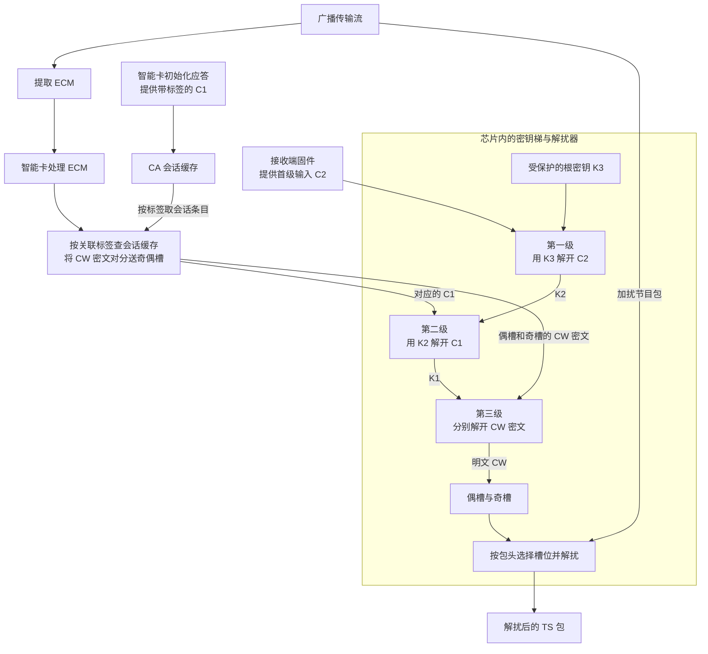
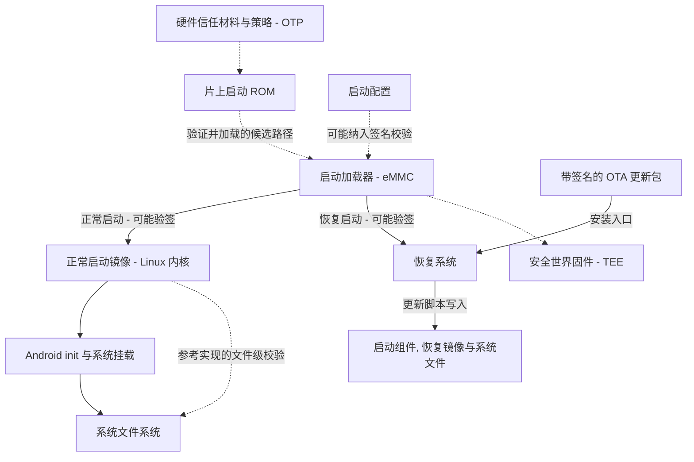

之前有人找我尝试给机顶盒的智能卡接口焊线来采集机顶盒与卡的通信. 我和他 (本文称为 Y) 聊了一下, 觉得这件事还挺有意思, 值得研究, 于是我就加入了这个神秘的研究.

最终目标: 使用尽可能少的资源, 把有线电视上的信号采集出来, 推流为类似 IPTV 的, 可以用电脑播放的视频流.

<!-- more -->

## Gaining Access

### 最开始的切入点: 智能卡接口

一开始的时候, Y 跟我说, 卡里面会解密出来一个 CW, 然后有一个 DES 算一下就能得到解密视频流的密钥. 他搞了一个机顶盒 (A) 过来, 于是, 我们首先把目光聚焦在机顶盒与卡的交界面上. 我给智能卡的触点拉了 8 根线接入逻辑分析仪, 拿到了 ISO7816 T=0 的部分数据. 一开始, 我找了一个 Saleae Logic 的 ISO7816 LLA 和 HLA 的库, 但是它解码出来的东西有点问题, 似乎是因为这个智能卡用了一大堆非标准的 Function ID, HLA 库不知道如何解码.

然后我把机顶盒给 Y, Y 说似乎机顶盒上面有一个 DES Key, 于是找人把 eMMC 芯片给吹下来, 读出来了, 我们有了第一份可以用于参考的 rootfs 代码. 后来 Y 表示, 在 Flash 上没有找到对应的密钥, 于是暂时倒闭.

### 紧接着的探索: UART 串口

硬件上有串口. 我引出了三根线出来, 接上去, 有输出, 没输入, 按什么都没反应. 有点用, 但不多.

### 固件带来的消息: ADB 调试

拆 eMMC 啥的的时候把 A 搞坏了, 接同轴线放不出电视了. 我从废品回收站捡了一台差不多的机顶盒 B.

好消息是, 拿到了固件. 考虑到大部分机顶盒都会有一些厂商模式或者调试模式的开关, 我让 Agent 去固件里面找了一圈, 还真找到了. 一个是, 在网络设置页面按一串电话, 能进入特殊的维护模式, 可以设置静态 IP 等; 一个是, 在厂商信息页面按 "上下左右中", 能开启 ADB 和串口. 但是, 我没有遥控器, 只有键盘, 中键是个什么键呢? 中键是 `KEYCODE_DPAD_CENTER`, Keycode 23; 键盘上没有这个键, 与之对应回车键是 `KEYCODE_ENTER`, Keycode 66. 于是, 我不得不开启了一段支线任务.

#### 怎么在没有遥控器的时候输入 `KEYCODE_DPAD_CENTER`

好在之前我装了一个 Kali NetHunters 的手机, 而 NetHunters 能模拟 USB 设备, 经常被当作 BadUSB 用. 我试图让 Codex 给我写一个用 HetHunters 模拟的脚本, 然后 6.2 Sol 拒绝了 (甚至没有 Cyber). 于是我打开了 ChatGPT 的网页版, GPT 找到了 "HID Consumer Control Page" 中的 "Menu Pick (0x0C:0x0041)" 会映射到 Linux `KEY_SELECT`, 进而映射为 Android `KEYCODE_DPAD_CENTER`. 让他给我写了一个:

```sh
#!/system/bin/sh
set -eu

# Locate USB gadget
G=""
for p in /config/usb_gadget/* \
         /sys/kernel/config/usb_gadget/*; do
    if [ -f "$p/UDC" ]; then
        G="$p"
        break
    fi
done
[ -n "$G" ] || { echo "USB gadget not found"; exit 1; }

# Choose gadget configuration
C=""
for p in "$G"/configs/*; do
    if [ -d "$p" ]; then C="$p"; break; fi
done
[ -n "$C" ] || exit 1

F="$G/functions/hid.dpad"

# Install consumer control HID function once
if [ ! -L "$C/hid.dpad" ]; then
    UDC=$(cat "$G/UDC")
    [ -n "$UDC" ] || { echo "UDC not bound"; exit 1; }

    echo "" > "$G/UDC"

    if [ ! -d "$F" ]; then
        mkdir "$F"
        echo 0 > "$F/protocol"
        echo 0 > "$F/subclass"
        echo 1 > "$F/report_length"

        # Consumer Control:
        # 0x41 Menu Pick
        # 0x42 Menu Up
        # 0x43 Menu Down
        # 0x44 Menu Left
        # 0x45 Menu Right
        printf '\005\014\011\001\241\001\025\000\045\001\165\001\225\005\031\101\051\105\201\002\165\003\225\001\201\003\300' > "$F/report_desc"
    fi

    ln -s "$F" "$C/hid.dpad"
    echo "$UDC" > "$G/UDC"
fi

# Locate the new HID character device
MINOR=$(cut -d: -f2 "$F/dev")
DEV="${HID_DEV:-/dev/hidg$MINOR}"

[ -c "$DEV" ] || { echo "Missing $DEV"; exit 1; }

# One-bit reports, followed by key release
send_key() {
    printf "$1" > "$DEV"
    sleep 0.05
    printf '\000' > "$DEV"
}

send_key '\002'  # UP
sleep 0.35
send_key '\004'  # DOWN
sleep 0.35
send_key '\010'  # LEFT
sleep 0.35
send_key '\020'  # RIGHT
sleep 0.35
send_key '\001'  # DPAD_CENTER

echo "Done"
```

然后把手机插到机顶盒上, 成功开启了 ADB.

### ADB to Root

ADB 进去之后是普通用户. 怎么搞到 root 呢? Kernel 没有开 KASLR, 也没有 AppArmor. 考虑到 Kernel 版本比较老, 尝试了拿 Kernel 的洞打; 不过 Agent (显然此处不是 GPT 了) 发现里面有一个 Samba 服务器的 config 是 777, 可以随便改, 而且 smbd 是 root 运行的.

因此 Agent 造了一个自定义的 VFS 模块, 构造函数执行 `rootcmd.sh`, 把这个模块给挂载到某个 share 上, 在访问这个 share 的时候就能执行命令. 然后弄了一个 `su` 二进制, 在 `rootcmd.sh` 里面 mount 一个新的 tmpfs 来避免 `nosuid`, 把 `su` 塞进去, 就拿到了本次启动能用的 root shell.

### Root to Persistence

那么如何开机启动呢? Agent 弄了一个应用, 接收启动完成的消息钩子, 在钩子上拉起需要的应用, 就做到了持久化.

### 固件更新啦...

于是我和 Y 觉得万事俱备, 只欠东风, 可以接上线长期调试了. 于是我们连上线, 我准备教 Y 如何使用 adb 和 scrcpy, 结果弄到一半, 盒子失联了. 我们回去看盒子的时候, 发现他网口不亮灯, 等接上线, 已经重新亮灯进系统了. ADB 这次没开, 我让 Codex 找了找, 发现一个厂家应用现在每次启动都会把 ADB 关掉. 于是我禁用了这个应用, ADB 又能开机自动启动了.

## Parsing Protocol

### TongFang3

回头看前面抓到的卡线数据. 盒子用的是同方三代卡 `NTIC3`. 复位后, 盒子先看卡发来的 ATR (Answer to Reset) 来认卡, 再发 `80 56` 建会话. 播电视的时候, 盒子用 `80 3A` 把 ECM (Entitlement Control Message) 交给卡. 卡回 `61 xx` 告诉盒子有多少字节可以读, 盒子再发 `00 C0` 去取.

下面的字节都按线上出现的顺序写.

#### T=0 命令头

盒子每次先发 5 字节的命令头.

```text
字节偏移     0x00       0x01       0x02       0x03
         +----------+----------+----------+----------+
0x00     |   CLA    |   INS    |    P1    |    P2    |
         +----------+----------+----------+----------+
0x04     |    P3    |
         +----------+
```

| 偏移 | 字段 | 含义 |
|---|---|---|
| `0x00` | `CLA` | `80` 为私有命令类别, `00` 用于 `GET RESPONSE` |
| `0x01` | `INS` | `46` 查询, `56` 初始化会话, `3A` 提交 ECM, `C0` 取回响应 |
| `0x02–0x03` | `P1 P2` | 命令参数. ECM 中为运营商 ID, 记作 `OP`, 占 2 字节, 高字节在前. 卡级初始化查询与取回响应中为 `00 00` |
| `0x04` | `P3` | `80 46`, `80 56`, `80 3A` 的发送长度 `Lc`, 或 `00 C0` 的读取长度 `Le` |

接下来轮到卡发过程字节. 卡回 `INS`, 就把剩下的数据传完. 回 `INS ^ FF` 就只传下一个数据字节, 回 `60` 就接着等. 开始传数据以后就按长度读. 卡也可以直接回两字节的状态码 `SW1 SW2`. 比如初始化的时候, 卡收到 `80 4E` 就直接回了 `94 92`. 这部分大体和 [ETSI TS 102 221](https://www.etsi.org/deliver/etsi_ts/102200_102299/102221/18.02.00_60/ts_102221v180200p.pdf#page=41) 对得上.

卡有数据要回的时候, 通常要走两个 TPDU. 卡先回 `61 N`, 盒子把里面的 `N` 填进 `GET RESPONSE` 的 `Le`. 下面表里的响应偏移, 都从 `C0` 过程字节后面的第一个数据字节开始算, 到 `SW1 SW2` 前为止. 卡回 `90 00`, 这个 TPDU 就正常结束了. ECM 的结果还得看响应里的数据.

大体就是这么来回发的:

```text
机顶盒 → 卡   CLA INS P1 P2 Lc       命令头
卡 → 机顶盒   INS                    ACK
机顶盒 → 卡   <Lc 字节>              请求数据
卡 → 机顶盒   61 N                   有 N 字节可取
机顶盒 → 卡   00 C0 00 00 N          GET RESPONSE
卡 → 机顶盒   C0 <N 字节> 90 00      ACK, 响应数据, 最终状态
```

#### Init 复位与会话初始化

卡复位后会自己发 ATR. 盒子先看 `0x04–0x07` 这 4 字节来认卡, 再看 `0x08` 的版本字符, 决定用哪套初始化流程.

```text
卡 → 机顶盒   3B 6C 00 00 | <4 字节卡类型标识> | <版本字符> | <7 字节历史数据>
```

##### 命令顺序

表里记的是卡对原命令回的状态. 每遇到一个 `61 xx`, 盒子都再发一条 `00 C0 00 00 xx` 把数据取回来, 卡回的最后两个字节都是 `90 00`.

| 顺序 | 命令头 | 请求数据 | 返回与含义 |
|---:|---|---|---|
| 1 | `80 46 00 00 04` | `07 00 00 08` | `61 08`, 取回 8 字节 |
| 2 | `80 56 00 00 22` | 34 字节, 见下表 | `61 1B`, 取回 27 字节会话数据 |
| 3 | `80 46 00 00 04` | `01 00 00 14` | `61 14`, 取回 20 字节卡身份. 前 4 字节为数值, 后 16 字节为身份字段 |
| 4 | `80 46 00 00 04` | `0C 00 00 00` | `61 0C`, 取回 12 字节运营商列表, 每条占 2 字节 |
| 5 | `80 48 00 00 04` | `01 00 00 13`, 随后以 `01 start_hi start_lo 13` 翻页 | 分页读卡记录. 终止页为 `00 00 00` |
| 6 | `80 40 OP 06`, `80 46 OP 04`, `80 4E OP 11` | `80 40` 发送 6 字节. `80 46` 依次发 `04 00 00 48`, `05 00 08 04`, `02 00 00 4F`. `80 4E` 为读请求 | 逐个初始化运营商. `80 40` 直接回 `90 00`, 三次查询分别取回 72, 4, 79 字节. 母卡配对数据读取直接回 `94 92`, 流程继续 |
| 7 | `80 46 00 00 04` | `03 00 00 09` | `61 09`, 取回 9 字节卡能力记录 |
| 8 | `80 48 OP 04`, 末尾再以 `P1P2=0000` 读卡记录 | 运营商记录为 `81 start_hi start_lo 3E`. `P1P2=0000` 时使用前面的 `01` 查询 | `start_hi start_lo` 为分页起点. 每个运营商的终止页为 `00 00 00` |

播起来以后, 盒子也可能再查运营商和卡记录.

##### Init 请求数据 `Lc=0x22`

| 数据偏移 | 长度 | 含义 |
|---|---:|---|
| `0x00–0x07` | 8 | 盒端生成的字段. 在重复初始化的样本中保持相同 |
| `0x08–0x0B` | 4 | 固件填入的常量 |
| `0x0C–0x11` | 6 | 固件从上下文取出的字段 |
| `0x12–0x21` | 16 | `FF` 后跟 15 个 `00` |

##### Init 响应数据 `Le=0x1B`

| 数据偏移 | 长度 | 格式 | 含义 |
|---|---:|---|---|
| `0x00` | 1 | `04` | 响应类型 |
| `0x01–0x08` | 8 | `<卡端字段>` | 同一张卡复位后, 抓到的值有变化 |
| `0x09` | 1 | `01` | 一个 tag |
| `0x0A` | 1 | `82` | 第一个条目的 tag |
| `0x0B–0x1A` | 16 | `<K1 密文>` | 盒端按 tag 缓存, 供后续 ECM 响应使用 |

看 `04` 这种回包, 从 `0x0A` 开始就是一条条等长的记录. 每条是一个 `tag` 加 16 字节的值, 下一条往后数 `0x11` 字节. 只有一条时, 响应长度就是 `0x0A + 0x11 = 0x1B`. 下面贴的是其中一次初始化拿到的 K1 密文. 同一张卡再做初始化, 我们看到这段密文变了.

```text
机顶盒 → 卡   80 56 00 00 22
卡 → 机顶盒   56
机顶盒 → 卡   <盒端字段 8 B> | <常量 4 B> | <上下文字段 6 B> | FF <15 个 00>
卡 → 机顶盒   61 1B
机顶盒 → 卡   00 C0 00 00 1B
卡 → 机顶盒   C0 | 04 <卡端字段 8 B> 01 82
                | 7A E9 8F E0 FB 3E BA F2 E7 75 AC 26 27 85 26 C1 | 90 00
```

#### ECM 请求与响应

机顶盒发给卡 `80 3A`, 盒子从 PMT 的 CA 描述符里找 ECM PID. 把那份 134 字节的 ECM section 对齐以后, `table_id` 在 `0x00`, `0x21–0x25` 是发给卡的命令头 `80 3A OP 60`, `0x26–0x85` 这 96 字节和卡线上的请求数据逐字节对得上. 要看卡线上那条请求对应哪个节目, 得一起对广播里的 ECM PID 和载荷.

```text
命令头   | 80 | 3A | OP 高字节 | OP 低字节 | Lc |
请求数据 | <                     Lc 字节                      > |
```

| 请求数据偏移 | 长度 | 本例布局 |
|---|---:|---|
| `0x00–0x02` | 3 | 私有前缀 |
| `0x03–0x07` | 5 | 抓到的 `4A` 回包在相同偏移上原样带回了这 5 字节, 看着像个 ID |
| `0x08–(Lc−1)` | 可变 | ECM 私有数据, 随广播 section 携带 |

| `Lc` | 观察到的响应 |
|---|---|
| `4B` (75 字节) | `61 46`, 取 70 字节 |
| `60` (96 字节) | `61 34`, 取 52 字节, 或 `61 46`, 取 70 字节 |

`Lc` 就是盒子这次要发多少字节. 等读完卡回的数据, 固件再看响应格式和标志, 决定接下来怎么走.

`61 46` 取回 70 字节, 代表成功, 带解扰数据:

| 响应数据偏移 | 长度 | 格式 | 含义 |
|---|---:|---|---|
| `0x00` | 1 | `4A` | `(flags & 0x03) = 2`, 选择类型 2. `(flags & 0x08) = 0x08`, 解扰数据标志置位 |
| `0x01–0x02` | 2 | `OP` | 运营商 ID, 与命令的 `P1 P2` 对应 |
| `0x03–0x07` | 5 | `<回显字段>` | 请求对应字段的回显 |
| `0x08–0x17` | 16 | 两个 8 字节块, 明文 CW 的位置, 均为零 | 这两个块均为零时, 本固件转入 TLV 解析 |
| `0x18–0x29` | 18 | 私有字段, 其中 `0x1C=01` | `0x1C` 参与固件的解扰数据检查 |
| `0x2A` | 1 | `00` | 前缀条目数, 本例为零 |
| `0x2B` | 1 | `12` | TLV 区总长 18 字节, 包含 tag 和 length |
| `0x2C–0x2D` | 2 | `82 10` | tag 为 `82`, value 长度为 `0x10`. 固件用 tag 查找 Init 缓存中的条目 |
| `0x2E–0x35` | 8 | CW 密文前半 | 在对齐的 96 字节 ECM 串中为当前周期 `current` |
| `0x36–0x3D` | 8 | CW 密文后半 | 同一串中为下一周期 `next` |
| `0x3E–0x45` | 8 | 私有尾部 | 看上去可能是认证码 |

下面贴个例子.

```text
机顶盒 → 卡   80 3A OP 60
卡 → 机顶盒   3A
机顶盒 → 卡   <ECM 请求数据 96 B>
卡 → 机顶盒   61 46
机顶盒 → 卡   00 C0 00 00 46
卡 → 机顶盒   C0 | 4A OP <偏移 0x03–0x29 的数据> 00 12 82 10
                | F2 33 E8 50 3A 17 D7 35   当前 CW 密文
                | 1F ED 53 00 C9 FF BA A4   下一周期 CW 密文
                | <私有尾部 8 B> | 90 00
```

`61 34` 取回 52 字节, 似乎代表失败, 再查询状态:

| 响应数据偏移 | 长度 | 本例布局 |
|---|---:|---|
| `0x00` | 1 | `40`, `(flags & 0x03) = 0`, `(flags & 0x08) = 0`. 固件转入后续状态查询 |
| `0x01–0x2B` | 43 | 样本中除 `0x19–0x1B` 的私有字段外, 其余字节为零 |
| `0x2C–0x33` | 8 | 私有尾部 |

接着查状态时, `P1 P2` 还是 ECM 用的那个运营商 ID, 发的数据是 `02 00 22 01`. 固件在这个分支里把 `00` 当成节目没订或者授权过期, 非零值就按卡冻结处理. 下面这次回的是 `00`.

```text
机顶盒 → 卡   80 3A OP 60
卡 → 机顶盒   3A
机顶盒 → 卡   <ECM 请求数据 96 B>
卡 → 机顶盒   61 34
机顶盒 → 卡   00 C0 00 00 34
卡 → 机顶盒   C0 | 40 00 00 ... (52 字节响应数据) | 90 00
机顶盒 → 卡   80 46 OP 04
卡 → 机顶盒   46
机顶盒 → 卡   02 00 22 01
卡 → 机顶盒   61 01
机顶盒 → 卡   00 C0 00 00 01
卡 → 机顶盒   C0 | 00 | 90 00
```

我让 Agent 照着这些交互写了个新的 HLA Parser, 但是鉴于版权等原因, 我就不放出来了.

### 密钥轴

卡回来的 CW 还是密文, 盒子怎么拿它来解扰呢? 查了一圈, 发现固件, 智能卡和广播流各出一部分数据. 芯片里有三级 TDES 密钥梯, 解出控制字以后, 硬件解扰器就用它来处理节目流.

#### 密钥层次与数据流

盒子里的条件接收 (CA) 模块从传输流 (TS) 里取出授权控制消息 (ECM), 再交给智能卡处理. 这里的 CW (Control Word, 控制字) 就是节目解扰用的密钥.

图里的 `K3 → K2 → K1 → CW` 是按 [公开规范 ETSI TS 103 162, §5–6](https://www.etsi.org/deliver/etsi_TS/103100_103199/103162/01.01.01_60/ts_103162v010101p.pdf) 写的. `C2`, `C1`, `CW 密文` 分别是这三级的输入, `K3`, `K2` 和 `K1` 则是每一级实际用的密钥. 芯片内的密钥梯和解扰器画在同一个框里, 表示它们的逻辑边界.



| 位置 | 输入与来源 | 产物与用途 |
| --- | --- | --- |
| 根密钥 | 芯片安全域中的根材料 | 有效 `K3` 供第一级使用 |
| 第一级 | `C2`, 16 字节, 由接收端固件提供. 固件具备按设备属性覆盖默认输入的逻辑, 不过我那个机顶盒使用默认输入 | `K2`, 用于解开 `C1` |
| 第二级 | `C1`, 16 字节, 来自卡初始化应答. CA 模块按标签缓存, 处理后续 ECM 应答时取用匹配条目 | `K1`, 用于解开该会话的 CW 密文 |
| 第三级 | 两个 8 字节的 CW 密文, 来自卡处理 ECM 后的应答. 在这条已核对的固件路径中, 负载前半送偶槽, 后半送奇槽 | 两个槽分别接收明文 CW, 解扰器按 TS 包头的加扰控制位选用 |

这套设计有意思的地方是 `C1` 由卡提供. 如果卡掌握 `K2`, 就可以自己选 `K1` 来生成 `C1`, 再拿 `K1` 把卡解出来的 CW 加密. 要是芯片里的密钥梯和卡都可信, 从外面硬破就很难了.

真要自己解, 一条路是导出根密钥 `K3`, 算出 `K2` 后脱离解扰器. 另一条路是找出卡里解 ECM 用的密钥 (听上去像是侧信道的活), 自己解 ECM 拿明文 CW. 这两条路听起来都挺难的.

#### 卡初始化与控制字轮换

```text
Time        ------------------------------------------------------->
Session     |----------- A ------------------|--------- B --------->
Card init   C1(A)                            C1(B)
ECM reply          A1           A2                      B1
                   |            |                       |
Cached key         C1(A)        C1(A)                   C1(B)
CW slots           even/odd     even/odd                even/odd
```

我们一共抓了十次初始化. 同一张卡每次收到的初始化请求都一样, 两张卡各自回的 `C1` 则每次都变. 回包里还有个单独的 8 字节字段, 抓到的值也有变化, 看着像 MAC.

ECM 回包里两个槽各有一份密文. `even` 和 `odd` 说的是放哪个槽, `current` 和 `next` 说的是按当时的时间点看, 哪份现在用, 哪份下一个周期用.

### 安全启动

这个盒子其实还有安全启动 (虽然启动起来的系统被我打得稀烂).

图里的实线画的是各个组件怎么加载, 运行和更新. 虚线是按参考实现推出来的校验和加载路径.



#### 硬件信任根与启动加载器

驱动的状态里能看到安全启动开着, RSA 密钥锁着, 启动模式是 eMMC. 参考驱动会分别从硬件接口读出安全启动状态和锁定标志. 系统属性里也写着启动校验开了.

eMMC 专用启动区的转储里全是零. 归档和转储里倒是留有 eMMC 用户区里启动加载器分区的记录与镜像. 结合参考实现和转储来看, 片上的启动 ROM (Boot ROM) 可能会用 OTP 里的信任材料, 校验并加载 eMMC 上的首段启动镜像.

#### 正常启动, 恢复与安全世界

正常开机就进 Linux 内核, 接着跑 Android `init`. 走恢复流程时, 进的是单独的恢复镜像. 参考构建流程里, 启动加载器, 启动配置, 正常启动镜像和恢复镜像都各自生成签名产物. OTA 里这四样东西和安全世界固件的对应负载, 都和设备上分区转储的有效前缀逐字节对得上. 参考流程里哪些东西会签名, OTA 里的镜像又分别对应哪些分区, 这两点可以用来还原启动链.

盒子里留有安全世界固件的分区, TEE 配置属性也是开的. 运行记录里既出现过相关用户态服务在跑的情况, 也有因缺少对应服务程序而记为服务已停用的日志. 图里把 TEE 单独画了一条分支. 按参考路径推测, 启动加载器也可能负责把 TEE 固件拉起来.

#### 系统文件完整性

| 项目 | 观察结果 |
| --- | --- |
| 系统分区 | 运行时从物理分区以只读 ext4 挂载, 挂载配置同样指定只读 ext4, 内核配置关闭了 `dm-verity` |
| 系统文件校验清单 | 设备系统镜像和 OTA 更新包中包含参考实现所用的清单 |

平台参考实现提供文件级完整性校验. 构建时生成并签署文件摘要清单, 运行时由内核侧校验清单签名, 再核对清单所列文件的摘要. 镜像与 OTA 包中的清单符合这一机制, 但目前不知道系统里实际到底有没有执行, 何时执行以及失败后如何处置. 只读挂载只管挂载权限, 而 AOSP [dm-verity](https://source.android.com/docs/security/features/verifiedboot/dm-verity) 这类块级完整性校验在内核配置里是关闭的.

#### OTA 更新与防回滚

这份按 [AOSP OTA 包结构](https://source.android.com/docs/core/ota/nonab/inside_packages) 组织的更新包使用包内签名证书对整包签名完成了离线密码学验证. 更新脚本将启动组件, 恢复镜像, 安全世界固件和系统文件写入对应位置, 离线结果确认了更新包与其签名的一致性. 不过恢复环境实际如何校验证书, 签名者是否获设备授权, 以及写入后的首次启动到底有没有重新验证各组件, 目前还不知道. 不敢测试.

至于[防回滚策略](https://source.android.com/docs/security/features/verifiedboot/verified-boot#rollback-protection), 目前同样不知道正常启动和恢复路径各自到底有没有开启.

## Third Box

前面说了一大堆的具体实现, 好像一开始我们就把它完全搞明白了一样. 实际上, 为了搞明白这些, 我们还很折腾了一番. 首先是, Y 又购买了盒子 C. C 到手的时候是一个装在原厂包装里面的全新的盒子 -- 但是是 19 年的全新. 这个盒子的硬件和 B 一样, 但是软件非常老, 以至于之前的开 ADB 脚本不好用了. 于是我在系统上折腾了半天, 失败, 迫不得已给他拆开往串口上接了线, 进去,

```sh
shell@Hi3798CV200:/ #
```

我无语了. 于是在串口打开 ADB, 进去也是 root. 搞了半天这玩意的系统压根就不是生产模式呗?

## Writing Software

总共有十几路 4K 台, 目标是尽可能简单地把同轴加扰信号变成网络流. 总共需要滤波-->解扰-->推流三大步, 解扰需要 ECM-->ECW-->CW. 所以瓶颈可能在好几个地方, 对应也有好几种可能的方向.

如果我们认为能把 ECM-->CW 的密钥打出来, 那么自然 IC 卡啥的都不重要了, 机顶盒也不重要了, 直接拿到解密密钥, 从 ECM 解密 CW 就行. 可惜, 不得行.

既然 ECM-->CW 不得行, 那么让 IC 直接吐出 CW 行不行呢? 尝试了一圈, 没成功.

所以现在只能 ECM-->ECW 了, ECW-->CW 的 3DES 密钥能不能弄出来呢? 很遗憾, 也不行.

所以 ECM-->ECW-->CW 这条链动不了了, 而这条链依赖机顶盒上的密钥梯, 所以 IC 卡和机顶盒一个都不能少. 而一个机顶盒的密钥梯只能扔进去一个 C1 (见密钥梯那一节), 或者说, 一个机顶盒只有一个密钥梯, 所以一个机顶盒只能绑定一张卡.

下面的问题就来到了滤波-->解扰-->推流的瓶颈. 一个机顶盒上面只有四个高频头, 可以同时锁定四个频点, 收四个 4K 的台; 而经过了一些测试, 机顶盒的解扰器的上限大概是 48MB/s, 能同时解扰 8 个台. 机顶盒使用千兆网, 网络上带宽很充裕, 这是否意味着我应该从网络输入流呢?

我们进行了一些测试, 发现, 如果喂给卡超过 4 条流, 过一段时间之后, 卡会进入锁定状态, 拒绝解密 ECM. 放眼望去, 卡成为了硬瓶颈.

因此, 软件的架构就比较清楚了: 使用机顶盒滤波, 读卡, 解扰, 用 HTTP 流向外界暴露输出, 一个机顶盒可以输出 4 条流.

有 Agent, 写软件就相当方便了. 我让 Agent 给我糊了一个两级结构, 一部分 C 写的在 Android 上操作解扰 (Android 上有一些依赖库), 一部分 Go 写的放在 Debian chroot 里面做 Web Server. 结果, C 上面没有那些依赖库. 我干脆让 Agent 上网找到了 SDK, 编译了一份 Linux 的库, 把所有的东西都拿 Go 重写了.

## By-products

然后呢... 中间还有一些曲折的过程, 也产生了部分副产物.

### DVB-CSA1 爆破

也是老本行 (?) 了. DVB-CSA1 的 CW 只有 48bit 的熵, 因此爆破是可能的. 加之, MPEG 里面有标志性的头 `00 00 01 E0`, 因此可以检查爆破出来的明文是否符合这样的头, 做提前跳过. 我在网页版的开源实现上, 让 Agent 搓了一个 [CUDA 的](https://github.com/84634E1A607A/biss-cuda), 然后花了 30min 爆了一个 CW 出来. 这成为了我们发现之前的 DES 推断不对, 转向认真研究密钥轴的重要转折点.

### DVB-CSA1 选择密文攻击

后来在发现卡是瓶颈之前, 我还思考了是否能从密钥轴里面, 通过构造包的方式

通过构造包, 可以让包的大小为 8+7 字节, 则按照 DVB-CSA1, 前面的 8 字节过 Block Cipher 做 Stream Cipher 的 IV, 后面的 7 字节只过 Stream Cipher. 此时, 我们可以跳过 Block Cipher 的解密, 直接通过 IV + 7 字节的 Stream Cipher 来判断密钥是否正确, 这样可以显著减少一个分组的计算量. 同时, 由于 Stream Cipher 的特性, 可以充分利用其按照字节输出结果的特性, 提前跳过没用的部分. 如果给一个 15 字节的 0, 让密钥梯解扰出结果, 就能以一个更快的速度搜索密钥空间 (对于我这里, 我让 Agent 自己优化了一下, 得到了相对于上一节爆破 15 倍的性能提升).

在此基础上, 我考虑了使用彩虹表来在 7s 内解密 CW 的可能性, 即, 将加密的 CW 装入密钥梯, 然后令其解密构造的 TS 流获得明文, 之后查找彩虹表得到密钥.

不过在我将后面彩虹表付诸行动之前, 我们就发现了一张卡只能解 4 条流这个问题, 于是作罢.

## Net Output

总之, 实现了一个能把有线电视上的 4K50, 40Mbps HEVC 流在线解扰并变成 IPTV 的东西. 我的 Xe 核显甚至解码不动这个流 (), 但是研究还是有意义的!
